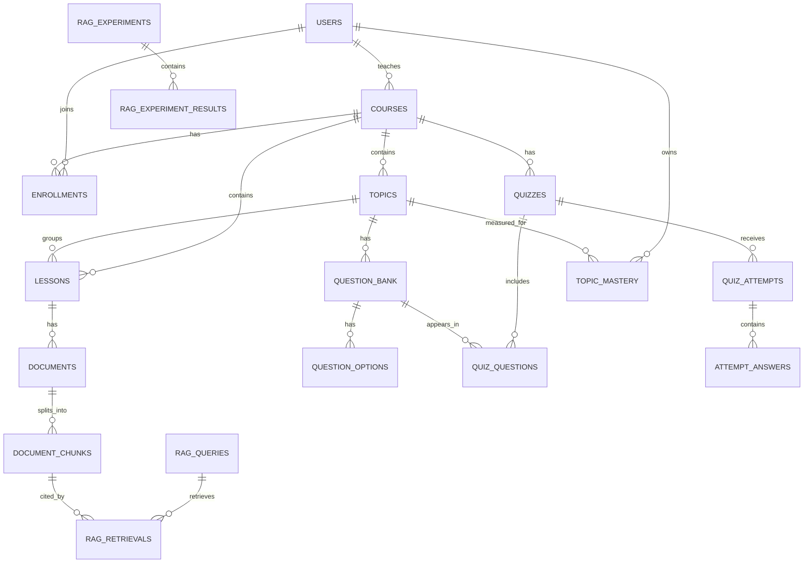

# Thiết kế cơ sở dữ liệu MySQL

## 1. Mục tiêu

Cơ sở dữ liệu lưu người dùng, nội dung khóa học, câu hỏi, kết quả làm bài, mức độ nắm vững và log RAG. Vector được quản lý bởi vector store; MySQL chỉ lưu nội dung chunk, metadata và khóa liên kết tới vector store.

## 2. Các nhóm bảng

| Nhóm | Bảng |
|---|---|
| Tài khoản | `users`, `refresh_tokens` |
| Khóa học | `courses`, `enrollments`, `topics`, `lessons`, `learning_progress` |
| Học liệu RAG | `documents`, `document_chunks` |
| Câu hỏi và kiểm tra | `question_bank`, `question_options`, `quizzes`, `quiz_questions`, `quiz_attempts`, `attempt_answers` |
| Cá nhân hóa | `topic_mastery`, `review_recommendations` |
| Log và thực nghiệm RAG | `rag_queries`, `rag_retrievals`, `rag_experiments`, `rag_experiment_results` |

## 3. Quan hệ chính

## 4. Cách lưu điểm nắm vững

Bảng `topic_mastery` lưu năm thành phần đã nêu trong đề cương:

- `accuracy_component`: A.
- `difficulty_component`: D.
- `repetition_component`: R.
- `history_component`: H.
- `time_component`: T.
- `mastery_score`: M trên thang 0-100.

Backend tính công thức `M = 100 × (0,45A + 0,20D + 0,15R + 0,10H + 0,10T)` rồi lưu kết quả. Không dùng trigger vì công thức thuộc nghiệp vụ Node.js và cần dễ kiểm thử.

## 5. Thiết kế bảo mật

- Chỉ lưu `password_hash`, không lưu mật khẩu thuần.
- Refresh token được băm trước khi lưu.
- Node.js dùng tài khoản `datn_app` có quyền giới hạn, không dùng `root`.
- Các khóa ngoại bảo vệ tính nhất quán.
- Tài khoản và khóa học được chuyển trạng thái thay vì xóa tùy tiện.

## 6. File triển khai

- `database/schema.sql`: tạo database và 21 bảng.
- `database/seed.sql`: tạo học phần JavaScript và 10 chủ đề.
- `database/create-app-user.sql.example`: mẫu tạo tài khoản ứng dụng.
